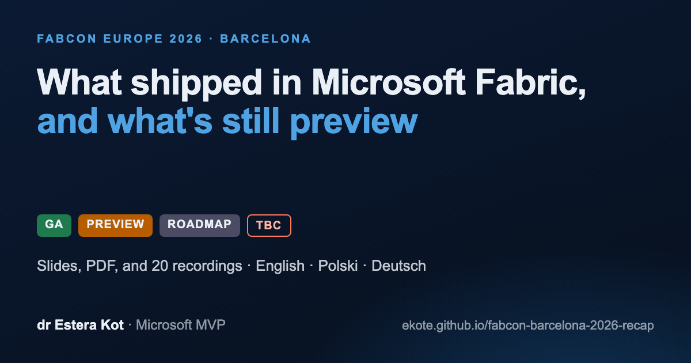
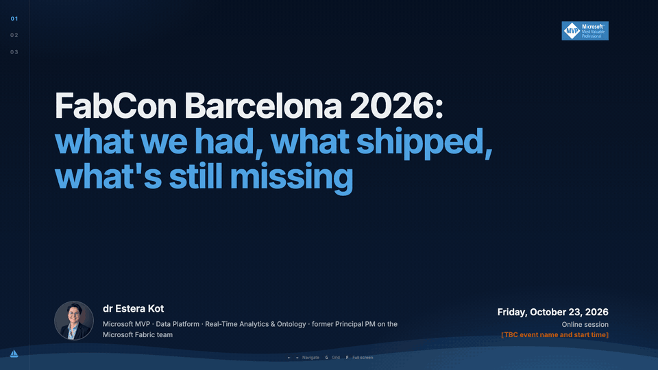
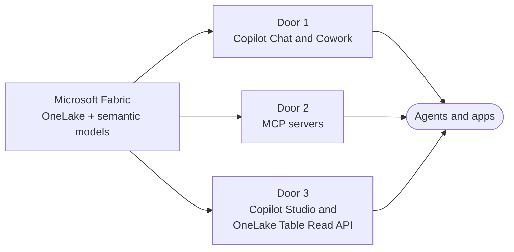
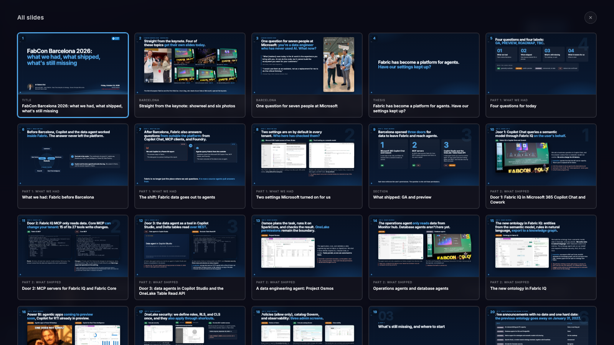

  

 

# FabCon Europe 2026 Barcelona recap: what shipped in Microsoft Fabric, GA vs preview

FabCon and SQLCon Europe 2026 ran from September 28 to October 1, 2026, in Barcelona. The keynote on September 29 turned Microsoft Fabric into a platform for agents: Microsoft 365 Copilot Chat, MCP clients, Copilot Studio, and apps can now pull answers from Fabric data. This recap labels every announcement GA, PREVIEW, ROADMAP, or TBC, checked against Microsoft Learn on October 21, 2026. It comes with slides in English, Polish, and German, PDFs, and 20 recordings from a demo tenant with synthetic data.

**Read it as a web page:** [ekote.github.io/fabcon-barcelona-2026-recap/](https://ekote.github.io/fabcon-barcelona-2026-recap/)

## Key takeaways

- Fabric data now leaves Fabric through three doors: Copilot Chat and Cowork, MCP servers, and Copilot Studio plus the OneLake Table Read API. Each door enforces the user's permissions, so the real question is who set them.
- Two settings are on by default in every tenant: "Fabric data in Microsoft Copilot" in the Microsoft 365 admin center, and the AI setting on every semantic model.
- Much of what was announced is preview. Turn on what is GA, pilot what is preview on one workspace, model, or capacity, and put the rest off.

## Slides, PDF, and recordings

| Language | Slides | PDF | Where it was presented |
|---|---|---|---|
| English | [Open](https://ekote.github.io/fabcon-barcelona-2026-recap/en/) | [PDF](en/fabcon-barcelona-2026-recap-en.pdf) | Online session, October 23, 2026 |
| Polski | [Open](https://ekote.github.io/fabcon-barcelona-2026-recap/pl/) | [PDF](pl/fabcon-barcelona-2026-recap-pl.pdf) | Data Community Trójmiasto, meetup #34, Gdynia, October 21, 2026 |
| Deutsch | [Open](https://ekote.github.io/fabcon-barcelona-2026-recap/de/) | [PDF](de/fabcon-barcelona-2026-recap-de.pdf) | Online-Session, 23. Oktober 2026 |

## Three doors: how Fabric data reaches agents

Each door enforces the user's permissions. The question is who set those permissions.

## Status of every announcement

GA means generally available, PREVIEW means public preview, ROADMAP means announced with no date, and TBC means sources disagree or Learn shows no label. Checked against Microsoft Learn on October 21, 2026.

| ID | Feature | Status | What it means |
|---|---|---|---|
| S1 | **Fabric IQ in Microsoft 365 Copilot Chat and Cowork** |  | Business questions answered from a semantic model you control. No extra charge for AI tokens, queries still use your capacity. [Source](https://learn.microsoft.com/microsoft-365/copilot/copilot-powerbi-copilot-chat) |
| S2 | **Fabric IQ MCP server** |  | Read-only MCP server for Power BI reports and semantic models: search, metadata, and DAX queries under the signed-in user's permissions. [Source](https://learn.microsoft.com/fabric/iq/connectors/fabric-iq-mcp) |
| S3 | **Fabric Core MCP server** |  | Fabric REST operations as MCP tools. 27 tools, 15 of them write changes to workspaces, items, and permissions. Learn shows no status label. [Source](https://learn.microsoft.com/rest/api/fabric/articles/mcp-servers/core-remote/overview-core-mcp-server) |
| S4 | **Data agents in Copilot Studio** |  | A Fabric data agent as a tool for a Copilot Studio agent. Keynote: GA. The Learn walkthrough still says preview on October 21, 2026. [Source](https://learn.microsoft.com/fabric/data-science/data-agent-microsoft-copilot-studio) |
| S5 | **OneLake Table Read API** |  | Apps read Delta and Iceberg tables over REST. OneLake security filters rows and columns on every request. [Source](https://learn.microsoft.com/fabric/onelake/table-apis/read-table-data-rest-api) |
| S6 | **Project Osmos, the data engineering agent** |  | Plans, runs, and validates data engineering tasks on SparkCore. Tasks persist. Fabric and OneLake permissions remain the boundary. [Source](https://learn.microsoft.com/fabric/data-engineering/data-engineering-agent-overview) |
| S7 | **Operations agent in Monitor hub** |  | Read-only investigation of failed pipeline runs, as the signed-in user. Needs the Contributor role and workspace monitoring. [Source](https://learn.microsoft.com/fabric/real-time-intelligence/operations-agent/fabric-observability-investigation-overview) |
| S8 | **Database agents for SQL and PostgreSQL** |  | Announced at the keynote for Database Hub and VS Code, not available yet. Database Hub itself is in preview. [Source](https://azure.microsoft.com/en-us/blog/fabcon-and-sqlcon-2026-in-barcelona-building-the-data-foundation-for-microsoft-copilot-and-agents/) |
| S9 | **Ontology in Fabric IQ** |  | Built from semantic models, OneLake data, and documents. Rules in natural language, RDF and Turtle export. The previous ontology retires January 31, 2027. [Source](https://learn.microsoft.com/fabric/iq/ontology/overview) |
| S10 | **Agentic apps in Power BI Desktop** |  | Preview announced for the coming weeks. Included with Pro and PPU, up to 1 GB per app, with write-back. [Source](https://azure.microsoft.com/en-us/blog/fabcon-and-sqlcon-2026-in-barcelona-building-the-data-foundation-for-microsoft-copilot-and-agents/) |
| S11 | **Copilot for Real-Time Intelligence** |  | A Real-Time Dashboard generated from one sentence on an eventhouse. The product shows a Preview label. [Source](https://learn.microsoft.com/fabric/real-time-intelligence/copilot-generate-dashboard) |
| S12 | **OneLake security** |  | Roles, RLS, and CLS defined once and enforced across engines, also through shortcuts. GA announced for the coming weeks, with no date yet. [Source](https://learn.microsoft.com/fabric/onelake/security/get-started-security) |
| S13 | **Outbound access protection** |   | A workspace that blocks data from leaving. GA for OneLake shortcuts, preview for data agents. [Source](https://learn.microsoft.com/fabric/security/workspace-outbound-access-protection-data-agent) |
| S14 | **Purview DLP restrict access** |  | Blocks everyone, or only guests, when sensitive data is found in a Fabric item. GA per the keynote, Learn still showed preview on October 7, 2026. [Source](https://learn.microsoft.com/purview/dlp-powerbi-get-started) |
| S15 | **Policies in Fabric** |  | An allow list for the tenant or a capacity. Allow is the only effect, there is no Deny. [Source](https://learn.microsoft.com/fabric/governance/fabric-policies-overview) |
| S16 | **OneLake catalog Govern** |  | One admin screen for label coverage, DLP results, tenant settings, and recommended actions. Refreshes once a day. [Source](https://learn.microsoft.com/fabric/governance/onelake-catalog-govern) |
| S17 | **Observability: new Monitor hub, workspace monitoring, Activator alerts** |  | Run history and success rate for every job, workspace monitoring in an eventhouse, and job alerts. [Source](https://azure.microsoft.com/en-us/blog/fabcon-and-sqlcon-2026-in-barcelona-building-the-data-foundation-for-microsoft-copilot-and-agents/) |
| S18 | **OneLake catalog search API** |  | Search the whole tenant from code with POST /v1/catalog/search, also available as the search_catalog tool in Core MCP. [Source](https://learn.microsoft.com/rest/api/fabric/articles/onelakecatalog/overview) |
| S19 | **AI functions in Spark** |  | ai.translate, ai.analyze_sentiment, and ai.classify in one line per column, on a built-in endpoint with no API key. [Source](https://learn.microsoft.com/fabric/data-science/ai-functions/overview) |
| S20 | **Materialized lake views** |  | Silver and gold layers in SQL, with CONSTRAINT ... ON MISMATCH DROP for bad rows. Views authored in PySpark are in preview. [Source](https://learn.microsoft.com/fabric/data-engineering/materialized-lake-views/overview-materialized-lake-view) |
| S21 | **Fabric data agent** |  | Natural-language questions answered with SQL, DAX, or KQL over lakehouses, warehouses, semantic models, and KQL databases. [Source](https://learn.microsoft.com/fabric/data-science/concept-data-agent) |
| S22 | **OneLake table APIs: Unity Catalog API and Iceberg REST Catalog** |  | The same Delta tables read through Unity Catalog compatible and Iceberg REST Catalog endpoints, with no copy. [Source](https://learn.microsoft.com/fabric/onelake/table-apis/table-apis-overview) |

## Admin checklist: four tenant settings to check

1. **Check who can reach Fabric data from Microsoft 365 Copilot.** In the Microsoft 365 admin center, open the Copilot settings and find "Fabric data in Microsoft Copilot". It is on for all users by default. [Learn](https://learn.microsoft.com/microsoft-365/copilot/copilot-powerbi-copilot-chat)
2. **Review the AI setting on sensitive semantic models.** Check the AI setting on semantic models with HR and finance data. It lets anyone with read access use Copilot, the data agent, and MCP tools, and it does not carry over to chained models. [Learn](https://learn.microsoft.com/power-bi/create-reports/copilot-semantic-models)
3. **Check the cross-region AI tenant settings.** Check the tenant settings that let AI process or store data outside the capacity's region and geography. They matter for capacities outside the EU Data Boundary and the US, including the UK. [Learn](https://learn.microsoft.com/fabric/admin/service-admin-portal-copilot)
4. **Turn on outbound access protection where data is sensitive.** Turn on workspace outbound access protection for workspaces with sensitive data, so data cannot leave through shortcuts or data agents. [Learn](https://learn.microsoft.com/fabric/security/workspace-outbound-access-protection-data-agent)

## What's still missing

| ID | What | Status |
|---|---|---|
| R1 | On-demand billing and F0 capacity | Coming soon, no pricing yet |
| R2 | Database agents for SQL and PostgreSQL | Coming soon |
| R3 | Native ontology and semantic model support in IQ sharing | On the roadmap |
| R4 | Apache Ossie, a vendor-neutral ontology standard, together with Snowflake | Announced |
| R5 | GA date for OneLake security | Not given |
| R6 | Previous ontology experience | Retires January 31, 2027 |

## FAQ

<strong>What was announced at FabCon Europe 2026 in Barcelona?</strong>

The main announcements: Fabric IQ in Microsoft 365 Copilot Chat and Cowork (GA), the Fabric IQ MCP server (GA), the Fabric Core MCP server, data agents in Copilot Studio, the OneLake Table Read API (preview), Project Osmos (preview), operations agents (preview), a new ontology in Fabric IQ (preview), agentic apps in Power BI Desktop (preview in the coming weeks), OneLake security (GA announced for the coming weeks), policies in Fabric (preview), and on-demand billing with an F0 capacity (roadmap).

<strong>Is Fabric IQ in Microsoft 365 Copilot Chat generally available, and does it cost extra?</strong>

Yes, it is GA. There is no extra charge for AI tokens, but the queries still use your Fabric capacity, and each user needs a Microsoft 365 Copilot license. Data agents and ontologies answer in Copilot Chat only once they are published as a Microsoft 365 agent.

<strong>What is the difference between the Fabric IQ MCP server and the Fabric Core MCP server?</strong>

Fabric IQ MCP is a GA, read-only server for Power BI reports and semantic models: search, metadata, and DAX queries under the user's permissions and RLS. Fabric Core MCP exposes Fabric REST operations, and 15 of its 27 tools write changes to workspaces, items, and permissions. Learn warns that autonomous or misconfigured clients may perform destructive actions.

<strong>Is OneLake security generally available?</strong>

The keynote announced GA for the coming weeks without a date, and Learn gave no GA date on October 21, 2026. OneLake security defines roles, RLS, and CLS once and enforces them across Fabric engines and shortcuts. Every lakehouse has a DefaultReader role. The roles restrict users with Viewer or Read access, while Admin, Member, and Contributor keep broader access.

<strong>Does the Fabric data agent support languages other than English?</strong>

Officially, no. Learn describes questions in English. The Polish and German demo agents in this repo answered correctly, but outside official support, so test your own language before you rely on it.

<strong>Do I need the cross-geo processing setting for Copilot in Fabric?</strong>

Not for capacities in the US or inside the EU Data Boundary, which covers the EU and the EFTA countries, Switzerland included. Copilot for a Swiss capacity can still run in an EU datacenter outside Switzerland. Capacities in the UK and other geographies need the setting turned on.

<strong>When does the previous ontology experience in Fabric retire?</strong>

On January 31, 2027. The new ontology in Fabric IQ, in preview, replaces it.

<strong>What is Project Osmos?</strong>

Project Osmos is the data engineering agent in Microsoft Fabric, in preview. It plans, runs, and validates data engineering tasks on SparkCore, the tasks persist, and Fabric and OneLake permissions remain the boundary of what it can do. You start it from a coding agent such as GitHub Copilot CLI.

## Demo recordings

18 product demos from a demo tenant with synthetic data, the keynote showreel, and interviews with seven people at Microsoft. Every clip exists in English, Polish, and German takes.

| Slide | Recording | Length | Play |
|---|---|---|---|
| 2 | FabCon Europe 2026 keynote showreel | 26 s | [EN](en/media/fabcon-showreel.mp4) · [PL](pl/media/fabcon-showreel.mp4) · [DE](de/media/fabcon-showreel.mp4) |
| 3 | One question for seven people at Microsoft | 103 s | [EN](en/media/fabcon-interviews.mp4) · [PL](pl/media/fabcon-interviews.mp4) · [DE](de/media/fabcon-interviews.mp4) |
| 8 | The "Fabric data in Microsoft Copilot" setting | 12 s | [EN](en/media/S05-A23-copilot-admin-setting.mp4) · [PL](pl/media/S05-A23-copilot-admin-setting.mp4) · [DE](de/media/S05-A23-copilot-admin-setting.mp4) |
| 8 | The AI setting on a semantic model | 11 s | [EN](en/media/S05-A12-semantic-model-ai-setting.mp4) · [PL](pl/media/S05-A12-semantic-model-ai-setting.mp4) · [DE](de/media/S05-A12-semantic-model-ai-setting.mp4) |
| 11 | Fabric IQ MCP server | 23 s | [EN](en/media/S08-A2-fabric-iq-mcp.mp4) · [PL](pl/media/S08-A2-fabric-iq-mcp.mp4) · [DE](de/media/S08-A2-fabric-iq-mcp.mp4) |
| 11 | Fabric Core MCP server tools | 17 s | [EN](en/media/S08-A11-core-mcp-audit.mp4) · [PL](pl/media/S08-A11-core-mcp-audit.mp4) · [DE](de/media/S08-A11-core-mcp-audit.mp4) |
| 12 | OneLake Table Read API | 14 s | [EN](en/media/S09-A17-table-read-api.mp4) · [PL](pl/media/S09-A17-table-read-api.mp4) · [DE](de/media/S09-A17-table-read-api.mp4) |
| 13 | Project Osmos task in Fabric | 49 s | [EN](en/media/S10-A5-osmos.mp4) · [PL](pl/media/S10-A5-osmos.mp4) · [DE](de/media/S10-A5-osmos.mp4) |
| 14 | Operations agent investigates a failed pipeline | 47 s | [EN](en/media/S11-A6-operations-agent.mp4) · [PL](pl/media/S11-A6-operations-agent.mp4) · [DE](de/media/S11-A6-operations-agent.mp4) |
| 15 | Ontology agent in Fabric IQ | 47 s | [EN](en/media/S12-A8-ontology.mp4) · [PL](pl/media/S12-A8-ontology.mp4) · [DE](de/media/S12-A8-ontology.mp4) |
| 16 | Copilot generates a Real-Time Dashboard | 55 s | [EN](en/media/S13-RTI-copilot-dashboard.mp4) · [PL](pl/media/S13-RTI-copilot-dashboard.mp4) · [DE](de/media/S13-RTI-copilot-dashboard.mp4) |
| 17 | OneLake security roles | 14 s | [EN](en/media/S14-A16-onelake-security.mp4) · [PL](pl/media/S14-A16-onelake-security.mp4) · [DE](de/media/S14-A16-onelake-security.mp4) |
| 17 | Outbound access protection | 18 s | [EN](en/media/S14-A18-outbound-protection.mp4) · [PL](pl/media/S14-A18-outbound-protection.mp4) · [DE](de/media/S14-A18-outbound-protection.mp4) |
| 18 | Policies in Fabric | 16 s | [EN](en/media/S15-A13-policies.mp4) · [PL](pl/media/S15-A13-policies.mp4) · [DE](de/media/S15-A13-policies.mp4) |
| 18 | OneLake catalog Govern | 20 s | [EN](en/media/S15-A19-catalog-govern.mp4) · [PL](pl/media/S15-A19-catalog-govern.mp4) · [DE](de/media/S15-A19-catalog-govern.mp4) |
| 26 | OneLake catalog search API | 30 s | [EN](en/media/S16-A20-catalog-search.mp4) · [PL](pl/media/S16-A20-catalog-search.mp4) · [DE](de/media/S16-A20-catalog-search.mp4) |
| 27 | AI functions in a PySpark notebook | 29 s | [EN](en/media/S16-ai-functions.mp4) · [PL](pl/media/S16-ai-functions.mp4) · [DE](de/media/S16-ai-functions.mp4) |
| 28 | Materialized lake views with data quality rules | 84 s | [EN](en/media/S16-mlv-medallion.mp4) · [PL](pl/media/S16-mlv-medallion.mp4) · [DE](de/media/S16-mlv-medallion.mp4) |
| 29 | Fabric data agent answers from a lakehouse | 45 s | [EN](en/media/S16-data-agent.mp4) · [PL](pl/media/S16-data-agent.mp4) · [DE](de/media/S16-data-agent.mp4) |
| 30 | OneLake table APIs: Unity Catalog and Iceberg REST | 25 s | [EN](en/media/S16-onelake-open-catalogs.mp4) · [PL](pl/media/S16-onelake-open-catalogs.mp4) · [DE](de/media/S16-onelake-open-catalogs.mp4) |

## Viewing the slides

Open a slides link above, or download a language folder and open `index.html` in Chrome or Edge.

| Key | Action |
|---|---|
| Arrow keys | Next or previous slide |
| F | Full screen |
| G | All slides as thumbnails |
| Button in the corner of a video or image | Enlarge it, Esc to go back |

## About the author

dr Estera Kot is a Microsoft MVP (Data Platform), CTO at Clouds on Mars, and a former Principal PM on the Microsoft Fabric team. She attended FabCon Europe 2026 in Barcelona, and the demos ran in her own Fabric tenant on synthetic data. [LinkedIn](https://www.linkedin.com/in/esterakot)

## License

The slides, text, PDFs, and demo recordings are licensed under [CC BY 4.0](https://creativecommons.org/licenses/by/4.0/). Copy, share, and adapt them for any purpose, including commercially, as long as you credit the author and link this source:

> Based on "FabCon Europe 2026 recap" by dr Estera Kot, https://github.com/ekote/fabcon-barcelona-2026-recap, licensed under CC BY 4.0.

Not covered: the interview recording on slide 3, Microsoft product interfaces, logos, the meme image, the deck engine files, and the bundled fonts and icons. See [NOTICE.md](NOTICE.md) for details and [LICENSE](LICENSE) for the legal text.

Copyright 2026 dr Estera Kot. Microsoft, Fabric, Power BI, and related names are trademarks of Microsoft. Keynote photos and interview recordings were taken at FabCon Europe 2026 in Barcelona. Statuses change fast, so check the linked source before you rely on one.
